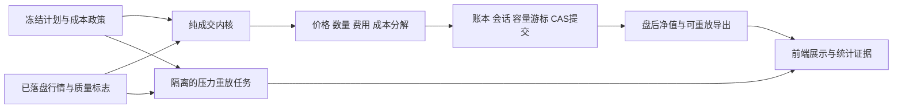

# P0：开盘成交成本与滑点模型

> 状态：实施中；批次 A（政策与统一成本内核）与批次 B 的盘口适配、质量标志、
> 日线观察隔离已实施；批次 C 的事前情景冻结、匹配完整路径、统一晋级重验、
> 独立导出与任务恢复已实施。批次 D 的独立数据导入、日期分块拟合、验证及发布流程
> 已实施；实际真实校准仍待券商委托/成交及同期盘口样本，现有两天模拟账本不构成真实校准。
> 设计日期：2026-10-11，时区 Asia/Shanghai。
> 代码依据：[c7652c1](https://github.com/sanchez0623/ashare-limit-lens/commit/c7652c1d38295423ecd371fa8c8a31d9d11fe25f)。
> 文档入口：[统一索引](../README.md)。配套方案：[统计证据与滚动显著性](statistical-evidence.md)。

目标是让模拟成交对开盘抢筹、昨日涨停、流动性和采样质量敏感，所有成本可以从冻结输入重放。收益核验不仅证明账本算对了，还必须说明用了什么成交假设、收益能否承受更差的执行条件。

首期保留腾讯 HTTP 10 秒轮询，使用确定性的分时成本模型和事前冻结的压力情景；有真实委托/成交或独立高质量盘口数据后再校准参数。AI 可以解释诊断，不能为了提高回测收益而降低成本参数。

## 1. 已核实的现状

| 位置                                                                             | 当前行为                                                                     | 改动要求                                                                             |
| -------------------------------------------------------------------------------- | ---------------------------------------------------------------------------- | ------------------------------------------------------------------------------------ |
| [`trading.js`](../../backend/domain/trading.js) 的 `RISK_LIMITS` / `executeFill` | 全时段固定 10bps；以最新成交价为参考；`Math.round` 生成分价格                | 抽出可版本化的成本模型；按时段、数量和输入质量计算；买入向上、卖出向下按价格单位取整 |
| [`realtime.js`](../../backend/domain/realtime.js) 的 `advanceSession`            | 用相邻报价累计量差建立流动性；首次/长缺口不虚构成交量；普通买单 09:35 后过期 | 保留因果量差与过期约束；增加成本上下文和同股区间成本状态                             |
| [`market.js`](../../backend/services/market.js) 的 `parseTencentQuotes`          | 解析价格、累计成交量、时间戳和涨跌停价；目前没有买卖盘口字段                 | 增加可选盘口字段与明确的质量标志；没有可靠盘口时用声明过的回退假设                   |
| [`backtest.js`](../../backend/services/backtest.js)                              | 历史分钟数据转换为观测，复用实时领域引擎；执行模型为 `MINUTE_SAMPLE_V1`      | 冻结成本政策；分钟采样和实时轮询分别记录质量与参数，不冒充同精度                     |
| `executePlan` 日线回退                                                           | 可能构造 `daily_open_assumption`、`volumeShares=null` 的开盘事件             | 新成本版本不以日成交量或未知量证明开盘可成交；这类结果只能作为观察模型               |
| [`portfolio-runner.js`](../../backend/services/portfolio-runner.js) / 赛马       | 主账户与影子账户共享纯执行器、各自独立账本                                   | 同一批次冻结相同政策；影子组合是独立假设路径，不和主账户争抢模拟容量                 |
| [`paper.js`](../../backend/services/paper.js) 的导出/核验                        | 导出与重放现有账本及输入                                                     | 导出政策、模型、成本状态和每笔成本分解；保留旧 10bps 的原版本重放                    |

10bps 等于价格的 0.1%，不是 10%；例如 ¥10 的参考价，忽略取整时买入价为 ¥10.01。单股 20%、总仓位 60%、参与率 1% 等硬约束与成本政策独立，AI 无权修改。

## 2. 建模依据与能力边界

交易成本包含显性收费和执行价格偏差。Almgren–Chriss 将执行风险及暂时/永久冲击纳入执行问题，支持把冲击与交易规模和执行方式联系起来；不能据此推导本系统 A 股开盘应该固定为多少 bps。[原始论文](https://doi.org/10.21314/JOR.2001.041)。

盘口研究发现短时价格变化与订单流不平衡及市场深度相关，单凭交易量解释冲击较不稳健。因此盘口缺失时采用保守代理，并清楚标注其证据等级；不能把美股研究系数直接移植到昨日涨停的 A 股。[Cont、Kukanov、Stoikov 原始论文](https://arxiv.org/abs/1011.6402)。

腾讯轮询能记录观测价格与累计量，不能证明自身委托真实成交、排队顺序或精确冲击。下面所有启动参数是**工程先验与压力假设，不是已测得的市场成本，也不是成本上界保证**。系统输出应称“指定成本模型下的模拟净收益”。

## 3. 政策、版本与默认假设

新增 `ExecutionCostPolicy`，与六项费用、策略参数分开存储。建议初版 `TIME_LIQUIDITY_V1`；旧模型显式命名 `LEGACY_FIXED_10BPS_V1`。

### 3.1 启动参数

| 参数                                | 初始建议 | 含义                                                 |
| ----------------------------------- | -------: | ---------------------------------------------------- |
| `periodBaseBps.openFirstMinute`     |       30 | 09:30:00 ≤ t < 09:31:00 的残余执行风险项             |
| `periodBaseBps.openNextFourMinutes` |       20 | 09:31:00 ≤ t < 09:35:00                              |
| `periodBaseBps.earlySession`        |       10 | 09:35:00 ≤ t < 10:00:00                              |
| `periodBaseBps.regular`             |        5 | 其他连续竞价时段；午休和集合竞价不执行               |
| `previousLimitUpPremiumBps`         |       15 | 昨日涨停标的的风险项，买卖均适用；由昨日冻结信息判定 |
| `unknownSpreadFloorBps`             |        5 | 缺少可用对手盘时的隐含价差回退                       |
| `impactBpsAtReferenceParticipation` |       10 | 达到参考参与率时的平均冲击项                         |
| `referenceParticipation`            |     0.01 | 冲击函数的归一化参与率，不能取代硬容量上限           |
| `impactExponent`                    |      0.5 | 单调冲击曲线的启动形状，后续由独立数据校准           |
| `openingParticipationCap`           |    0.005 | 09:30–09:35 的软容量上限；实际与硬上限取较小值       |
| `minuteQualityMultiplier`           |      1.5 | 分钟采样的残余成本倍数；不是实时滑点测量             |
| `stressResidualMultiplier`          | 1.5、2.0 | 两个事前登记的压力情景，基准为 1.0                   |
| `maximumSupportedCostBps`           |      300 | 模型适用域；超过后缩量或拒绝，不能截断成更便宜的成交 |

时段边界半开区间，09:35:00 属于早盘后段；普通买单能否在边界成交继续由订单窗口决定。成本分段不扩大任何交易窗口。低价股票的一分取整可能显著影响实际 bps，报告必须展示取整后的有效成本。

分段时刻取可因果执行的观察时刻，经 `marketClock` 转为 Asia/Shanghai；重放用持久 frame 的 observedAt，不用重放当天墙上时钟。报价时间戳另用于新鲜度/可用时点校验，不能简单截取 UTC 字符串当成本地时段。验收须覆盖同一时刻的 UTC/+08:00 两种表示及隔日重放，确认成本分段相同。

所有字段可通过后端校验后自定义，拒绝未知字段、非有限数、负值、原型字段及越界设置。软参与率不得超过现有 1% 硬上限；政策数值范围、压力倍数和校准状态纳入政策 schema，修改产生新版本。AI 提案白名单中不加入这些字段。

### 3.2 冻结与生效

政策包含 `id/version/modelVersion/payloadDigest/calibrationStatus/calibrationCutoff/effectiveFrom`。订单计划保存完整规范化政策或内容寻址引用及摘要，不能只存“当前设置”键。

新政策从下一个尚未冻结的计划生效，持仓本身不重置。活动研究窗口不允许混用成本政策：冻结政策继续服务已有批次；若必须改变批次规则，则取消该批资格并保留已消耗样本和尝试序号。连续主账户标注政策分段，不覆写历史盈亏。

旧计划缺字段时只能明确分派到旧 10bps 兼容执行器；新版本计划缺政策/摘要时暂停执行。旧报告不得因版本升级自动获得新成本口径下的启用资格。

## 4. 纯函数模型与成交算法

### 4.1 参考价与成本构成

首期参考价 `P0` 是经过日期、新鲜度和价格单位校验的当前观测最新成交价，盯市仍采用市场价格。对手报价可用时：买入锚点 `max(P0, ask1)`，卖出锚点 `min(P0, bid1)`；这只收取相对 P0 的不利价差，不假设总能取得优于 P0 的价格。

盘口必须同代码、同日、时间可比、价格为正且非倒挂；深度单位必须明确。字段缺失时才加回退价差项。已用对手盘作为价格锚点后，不再额外加同一份完整/半价差，避免双计。盘口数量也不等同于能得到的排队容量。

残余 bps 由时段项、昨日涨停项和数量冲击项组成。数据质量倍数、压力倍数作用于残余项和回退项；真实观测价差保留原值并单独展示。卖出不能使用负滑点奖励策略，买卖方向分别采用不利价格。

### 4.2 数量冲击与拆单一致性

`V` 为本次已完成、可验证的市场成交量区间，`Q` 为同一账户、代码、区间内已模拟成交的累计绝对数量。冲击总成本代理函数为：

```text
p(Q) = Q / V
F(Q) = P0 × Q × κ × (p(Q) / p_ref)^γ / 10000
本次 q 的冲击金额 = F(Q + q) - F(Q)
本次平均冲击 bps = 10000 × [F(Q + q) - F(Q)] / (P0 × q)
```

其中 P0 使用区间冻结锚点，货币单位统一为分；κ、γ 均由政策给定。使用累计成本差，使同一价格/区间下拆成多笔不会获得更低的模型冲击。状态保存整数数量和确定性累计成本，舍入规则冻结；实际成交价按分取整带来的额外不利成本也入审计字段。

本模型只改变自己的成交现金流，不把模拟冲击写回腾讯行情或给其他独立影子组合制造新价格。它是成本代理，不是完整订单簿模拟器。

### 4.3 成交步骤

1. 核验计划成本版本、政策摘要、报价质量、T+1 可卖数量、交易窗口和涨跌停约束。
2. 从真实相邻累计量差或已完成分钟区间取得 V；首帧仅预热，零量、负量、长缺口、未知量都不新增容量。
3. 初始数量取订单需求、硬参与率、开盘软参与率、剩余共享容量和可卖数量的最小值；买入仍按 100 股向下取整。
4. 对候选 q 计算累计冲击、有效成交价、费用和总资金需求。买入价向上取整、卖出价向下取整；政策支持范围之外缩量或拒绝。
5. 买入按含成本价同时检查现金、单股和总仓位上限；数量与冲击相互影响，使用单调搜索找到可成交数量，再核对整数边界。搜索最多随手数对数增长，不能循环减少几百万手阻塞轮询。
6. 含成本价超过买入上限，或触及涨停买入/跌停卖出保守边界时拒绝；不得把价格硬裁到涨跌停价后假装成交。保护退出保留已触发状态，后续按序重试。
7. 提交成交现金流、FIFO 成本和费用；滑点已进入成交价，不再从净值额外减一次成本。
8. 只有本次账户 CAS 成功才推进容量、冲击游标和订单状态；失败重读原持久状态再试。

数量不能先按低滑点算好、成交时再悄悄加成本。成本不能成为突破 T+1、追价上限或硬风控的理由；未成交和未完成 T 两腿照实保留。

### 4.4 容量状态与因果输入

实时区间用相邻有效报价时间戳及 frame 标识，不能按每笔订单重新获得完整 V。保护卖单、普通卖单、买单和 T 两腿共享同股区间的绝对成交容量。日线事件执行分支也必须共享事件容量，不能每个订单各使用一次 1%。

`session.executionState` 建议保存：`policyDigest`、`byCode.intervalKey/referencePriceCents/marketVolumeShares/consumedShares/cumulativeImpactCents`。同一账户和报价区间累计消费，不同独立候选账户各有自己的状态。

实时价格、量差、过去波动和盘口只取执行时已经落盘的输入。历史分钟量只有该分钟结束后才可用；注明 provider 的时间标签含义，不能在分钟开始用整分钟未来成交量。可供重放的时间序列包含 `availableAt`，扩展现有因果检查。

没有分钟/实时量的日线观察保留评分与观察收益，标记 `DAILY_OBSERVATION_ONLY`，不产生可用于晋级的开盘成交净收益。不能用全日成交量补开盘容量。

### 4.5 轮询延迟

第一批成本模型仍以“观测时尝试执行”为约定，记录 quote age、轮询间隔及该假设，不声称模拟了真实下单延迟。第二批增加因果延迟模式：订单触发后登记 `triggeredAt/eligibleAfter`，只用之后到达的有效观测成交；缺口不回填中间价格，09:35 后不延长普通买入窗口。

保护订单触发状态必须持久化，下一帧重放不能因价格恢复而取消已触发退出。T 第二腿不得早于第一腿成交观测。实时 10 秒与历史分钟延迟分别声明，不用时间插值伪造秒级执行。

## 5. 数据、审计与模块拆分

### 5.1 数据源扩展

`market.js` 的腾讯适配器增加可选 `bid1Cents/ask1Cents/bid1Shares/ask1Shares/orderBookTimestamp/quoteSchemaVersion`，字段映射先做脱敏原始响应 fixture 与单位核验。HTTP 接口缺乏稳定正式字段契约，解析失败必须降级并记录，不能假定某个数组索引永远代表相同字段。

昨日涨停标志来自冻结快照/前一交易日数据，持仓后不再涨停仍继续订阅。波动率扩展只能使用过去观测，开盘不足样本用声明的先验；不能使用当天最高最低价或收盘后得到的全天 ATR 来改善早盘成交。

### 5.2 成交记录

每笔增加 `executionCost`：模型/政策/情景版本、frame/interval 引用、参考价与对手盘、时段、昨日涨停标志、量差、q/V、此前累计 Q、各 bps 分量、取整前/后价格、实际隐含成本分、输入质量和回退原因。拒绝原因进入订单 outcome，并记录最终不成交数量；不只记录成功交易。

隐含成本为 `sideSign × (fillPriceCents - sourcePriceCents) × quantity`，买入 sideSign=1、卖出=-1。`feeCents` 继续只表示显性费用。累计滑点用于解释与核对，不再扣减账本权益。导出同时带 input digest 和政策 digest。

### 5.3 文件职责

| 新增/修改文件                                             | 职责                                               |
| --------------------------------------------------------- | -------------------------------------------------- |
| `shared/execution-cost.js`                                | 政策字段、单位、范围和 DTO，供前后端共用           |
| `backend/domain/execution-cost.js`                        | 纯成本估计、价格取整、累计冲击函数与数量求解       |
| `backend/domain/trading.js`                               | `executeFill` 调用模型，保留统一现金/持仓记账      |
| `backend/domain/realtime.js`                              | 输入上下文、区间状态、共享容量及延迟状态机         |
| `backend/services/market.js` / `quote-stream.js`          | 盘口规范化、质量标志、原始输入引用                 |
| `backend/storage/execution-cost.js`                       | 政策版本和校准报告的持久化                         |
| `backend/services/execution-cost.js`                      | 设置、生效计划、诊断与校准编排                     |
| `backend/services/execution-sensitivity.js`               | 隔离的多情景完整重放和收益敏感性                   |
| `paper.js` / `backtest.js` / `validation.js`              | 全部执行入口传入冻结政策，导出与重放兼容           |
| `research.js` / `strategy-tournament.js` / `promotion.js` | 冻结/核验成本与执行指纹，失配不给晋级              |
| `frontend/paper.js` / `frontend/strategies.js`            | 设置、模型标签、成本拆解和压力对比，只显示后端结果 |

纯函数不读数据库、不请求行情或 AI；前端不负责成本计算。复用现有 CAS、行情帧和任务系统，不再创建一套成交账本。

建议函数契约：

```js
normalizeExecutionCostPolicy(input); // 严格 schema → 规范化的不可变政策
buildExecutionContext({ plan, observation, previousQuote, intervalState });
estimateExecutionCost({ policy, context, side, quantity, consumedShares });
// → { supported, referencePriceCents, fillPriceCents,
//      costBreakdown, nextIntervalState, rejectionReason }
solveFillQuantity({ book, order, policy, context, intervalState, feeConfig });
// → { quantity, executionCost, nextIntervalState }，不修改传入账本
applyFillToBook({ book, order, fill, feeConfig });
// executeFill 仍负责记账；返回新的状态/ledger，存储层负责 CAS
replayExecutionSensitivity({ frozenManifest, inputs, scenarios });
// → 每个情景的独立 run 及完整账本/对照结果
```

`buildExecutionContext` 的 `plan` 提供事前标志/政策，`observation` 仅提供当前可用输入；不得从全日 dataset 隐式读取尚未发生的 high/low/volume。数量求解只返回候选状态，试算和 CAS 失败都不消耗真实容量。第一批接口可作为 `executeFill` 内部调用，避免所有上层重复实现。



### 5.4 存储与接口

新增迁移与 schema：`execution_cost_policies(id, version, model_version, payload, digest, effective_from, created_at)`、`execution_cost_calibrations(id, input_digest, cutoff, report, digest)`、`execution_sensitivity_runs(id, namespace, manifest, status, result_digest)`。计划/session/ledger 的 payload 增加冻结字段，不覆写旧 payload；摘要包含新增字段。

建议接口：`GET/PUT /api/paper/execution-cost`、`GET /api/paper/execution-cost/diagnostics`、`POST /api/research/execution-sensitivity`、`GET /api/research/execution-sensitivity?id=...`。写操作沿用 method、origin、身份及参数校验；GET 不执行校准或完整回测。接口只传政策与业务结果，不传环境值、密钥或未经处理的上游错误。

新模型同时升级实际执行语义指纹、历史执行版本和导出 schema。指纹至少包含引擎构建摘要、政策摘要、行情 schema、采样/延迟规则，不能只改一个固定字符串。报告和晋级入口均核验，不能只在生成报告时检查。

数据库迁移不把旧成交标注为新模型；历史兼容执行器仍按原 `Math.round`、10bps 及原容量规则重放。新导出注明 schemaVersion，verifier 必须按记录版本分派，不能用新算法重写旧成交后再宣称账本不一致。

## 6. 校准与压力测试

### 6.1 证据等级

| 状态                    | 允许结论                                                               |
| ----------------------- | ---------------------------------------------------------------------- |
| `PRIOR_UNCALIBRATED`    | 工程假设下的模拟结果；展示基准与压力区间                               |
| `QUOTE_PROXY_VALIDATED` | 报价价差、延迟变化和流动性代理已做独立验证；仍不能证明真实自身冲击     |
| `EXECUTION_CALIBRATED`  | 有合法取得的真实委托/成交及 contemporaneous 盘口，可估计成交冲击与误差 |

纸面成交由本模型生成，不能拿这些“成交”反过来证明模型参数正确。后续真实执行样本按开盘时段、昨日涨停、成交额/价差及参与率分层，报告样本量、P50/P90/P95 成本、覆盖和失败成交；只观察成功成交会产生选择偏差。

校准使用截止日以前的独立数据，日期区块划分训练和后续验证；验证区间不回头调系数。样本不足的分层使用保守先验，不能为了凑校准率填零。校准数据的所有者与角色也进入研究血缘，不能偷偷用正式前瞻窗口收益反调执行成本。

### 6.2 完整路径敏感性

在提案冻结时声明基准、1.5 倍和 2 倍残余成本情景。每个情景完整运行父策略、候选和固定基线，使用相同期初账户、行情、费用和窗口，各自重新生成因果计划与成交；不是在最终利润上统一扣一点费用。成本变化会改变仓位、可买数量、保护退出和后续信号。

报告展示净收益、两类对照超额、回撤、显性费用、隐含成本、成交率、未成交数量、T 未恢复数量及数据质量。较高成本的完整路径不一定产生更低总收益，因为可能少做亏损交易；单笔价格/成本必须单调，不能强行要求每条资金曲线排序单调。

压力分析在独立研究 namespace/runId 下执行，不写主账户、不重复占用正式测试日期，也不增加一次选优机会。情景集不得在看结果后选最有利的一档。首期将压力稳健性设为额外经济闸门：候选在全部预登记情景相对父策略和固定基线均达到冻结的经济门槛，否则不自动启用。

基准显著性仍使用既有尝试预算；如果以后允许“任选一个成本情景显著就晋级”，必须重新设计多重比较预算。成本压力区间不是收益统计置信区间，页面与 AI 输入中分别标明。

## 7. 验证与验收

| 必须验证的场景                             | 验收结果                                                       |
| ------------------------------------------ | -------------------------------------------------------------- |
| 同价同量同标的，09:30/09:34/09:40/普通时段 | 成本分段准确，开盘残余项更高；边界与交易窗口无歧义             |
| q 或累计 Q 增大、V 减小                    | 冲击不下降；支持域之外不截成低成本成交                         |
| 同区间一次成交与拆成数笔                   | 累计模型冲击相同，最多存在声明的价格单位差；不得重新拿完整容量 |
| 多订单、保护单和 T 两腿                    | 总绝对成交量不超过同股区间预算；两腿时序和 T+1 保持有效        |
| 盘口可用/缺失/倒挂/单位异常                | 没有价差双计；异常有可审计回退或拒绝                           |
| 零量、首帧、跨午休、停机缺口、累计量回退   | 不凭缺口量成交，不用日成交量补开盘容量                         |
| 含成本超过追价上限/涨跌停边界              | 如实不成交；保护触发状态与现有仓位保留                         |
| 低价股、现金仅够一手、手续费最低额         | 不利取整、无负现金、逐笔 FIFO/盈亏守恒，成本不重复扣           |
| CAS 冲突、重复 frame、重启                 | 成交与成本状态最多提交一次，按帧恢复                           |
| 主账户、匹配对照、历史分钟重放             | 同政策同输入可复现；采样差异显式登记                           |
| 政策中途修改/旧报告人工或 API 重试         | 统一入口检测指纹，不绕过成本闸门                               |
| 无分钟日线回退                             | 仅观察，不标可信开盘净收益，不参与晋级                         |
| 三个情景完整重放                           | 不影响主账户，完整结果可独立复核，不能只扣利润                 |

交付 `verify:execution-cost` 命令，检查政策/输入摘要、分解和价格、资金/持仓、共享容量、版本分派以及压力结果。测试使用合成边界样本和脱敏真实响应 fixture，不把已知期望值写死成实现镜像。

性能验收在目标 Windows 机器上测量：纯成本模型批处理不得引入网络；10 秒轮询不因校准/压力测试延长。记录原模型与新模型的 p95 执行耗时；长任务分片并租约恢复。合成性能不能代替目标机器数据。

## 8. 实施批次与完成标准

1. **批次 A：政策与统一成本内核。** 版本冻结、分时先验、累计冲击、同股共享容量、含成本缩量和逐笔审计；主账户/影子/历史入口及旧版本 verifier 同时接入。完成前不把新模型收益当可信成本结果。
2. **批次 B：输入质量与恢复。** 盘口适配、分钟可用时间、因果延迟、CAS/停机/T 回归；新增 API 和前端设置/成本展示。日线观察与可信成交结果彻底区分。
3. **批次 C：完整压力与研究闸门。** 三情景因果重放、对照匹配、成本版本核验、统一晋级入口及独立导出。与统计方案一起验收经济效果和显著性。
4. **批次 D：真实校准。** 有合规可用的真实执行/盘口样本后实施；在此之前保持 `PRIOR_UNCALIBRATED` 或代理验证标签，不宣称已获得真实冲击成本。

P0 的第一阶段关闭标准是 A–C 全部通过，旧收益口径保留并有清楚的模型标签，新研究不再默认全时段 10bps；当前数据不足以保证真实成本准确的部分由证据等级和压力结果明确表达。D 是提高外部有效性的后续工作，不能靠纸面成交自证完成。

## 9. 批次 C/D 已实施接口与使用

迁移 `0016_execution_cost_evidence.sql` 新增不可变成本压力报告、路径检查点、独立校准输入，以及政策到校准报告的引用；`0017_calibration_isolation.sql` 增加日期用途、实际样本身份和首次协议索引，不修改旧计划、成交、权益或统计报告。现有批次若没有事前压力声明，不补写事后情景，不能据旧报告晋级，需要新建批次。

### 9.1 正式成本压力闸门

批次预留、模型请求之前冻结完整成本政策、执行源码构建摘要、父策略、情景集合及经济门槛。必含 1/1.5/2 倍，额外情景也必须全部通过；模型不能选择情景或门槛。捕获时冻结完整主账户账本，包括继承持仓、费用、风险峰值和恢复状态。所有路径使用同一起点与冻结窗口；实时窗口读取赛马实际共享的 `quote_frames`，不换成主账户单独监控的股票池。

每个情景重新生成父策略、固定基线和所有候选的因果计划、成交与净值。候选必须比父策略期末权益多 **超过期初权益的 0.1%**，并严格高于固定基线；窗口回撤不超过 10%，且比父策略最多恶化 0.5 个百分点。缺行情/分钟、实时帧断档、盘口时序或对照覆盖不足，记 `INCONCLUSIVE`；经济门槛失败记 `REJECTED`。原有正式统计预算、轮次与净值闸门继续适用，成本情景不新增统计选优机会。

赛马报告展示每情景两类超额、回撤和闸门；完整导出另含显性费用、隐含成本、成交率、未成交股数、T 未恢复股数、质量分布、逐笔成交和权益曲线。压力范围不是收益置信区间。自动启用、人工/API 重试均在统一入口按存储的批次、实际输入和完整路径重新核验；旧单候选启用入口不能跳过成本闸门。

计算在交易日及每 100 个实时帧之间让出执行时间。任务使用独立 `EXECUTION_STRESS` 租约和完整路径检查点；中断后复用完成路径，过期租约可恢复，活动租约不把候选判为失败。正式报告提交检查租约所有者。计算不写主账户，不占用研究测试日期；离线 verifier 不信任检查点，独立重算全部路径。执行源码指纹由构建时实际源文件内容生成；离线核验须使用同版本执行代码。

### 9.2 真实校准输入与闸门

当前有日 K、5 分钟 K、复权因子、涨停池历史，以及本系统两天模拟委托/成交账本。这些用于策略重放和账本核验，不作为真实执行校准。5 分钟 OHLC 也不能还原委托时刻的买卖盘口和排队。

导入标准 JSON，价格单位 **分**、数量 **股**、时间带 `Z` 或 `+08:00`。仅接受 `REAL_EXECUTION`，登记数据所有者、真实来源、数据集引用和 `INDEPENDENT_CALIBRATION` 角色；包含失败/撤单/部分成交。导入者须声明委托记录完整，不能只提供成交成功的样本。系统核验格式、身份、时序和计算；来源声明本身不等于券商凭证认证。

最小结构示例（只展示格式，不是真实样本，单条数据不能取得校准资格）：

```json
{
  "schemaVersion": 1,
  "kind": "REAL_EXECUTION",
  "provenance": {
    "owner": "脱敏数据所有者",
    "source": "券商原始导出",
    "datasetRef": "脱敏数据集引用",
    "role": "INDEPENDENT_CALIBRATION",
    "paperGenerated": false,
    "ordersComplete": true
  },
  "trainingEnd": "2026-01-05",
  "cutoff": "2026-01-08",
  "orders": [
    {
      "id": "脱敏委托ID",
      "code": "600001",
      "side": "BUY",
      "quantity": 1000,
      "submittedAt": "2026-01-02T10:00:00+08:00",
      "completedAt": "2026-01-02T10:00:02+08:00",
      "status": "FILLED",
      "previousLimitUp": false,
      "marketVolumeShares": 1000000,
      "marketVolumeObservedAt": "2026-01-02T09:59:59+08:00",
      "quote": {
        "observedAt": "2026-01-02T09:59:59+08:00",
        "bid1Cents": 9990,
        "ask1Cents": 10010
      },
      "fills": [
        {
          "id": "脱敏成交ID",
          "executedAt": "2026-01-02T10:00:01+08:00",
          "quantity": 1000,
          "priceCents": 10025
        }
      ]
    }
  ]
}
```

未成交委托使用 `fills: []`，缺盘口使用 `quote: null`，均保留统计。盘口和量代理必须在委托前可用；拒绝未来盘口、倒挂盘口、非整数分/股、重复 ID、成交超量、状态与成交不一致。校准截止日只能为今日之前，且日期不能与 main namespace 已占用的正式测试/前瞻日重叠。导入与日期用途登记使用同一原子批次；研究预留、前瞻日登记和非训练样本用途的插入/更新均由数据库触发器反向排除校准日期。任一冲突整批回滚，不消耗研究预算、不留下部分校准输入。

导入时冻结基础政策与校准协议；按委托/成交的经济事实识别样本，名称、来源声明、外部 ID 改名、等价时区表示和训练分界不产生新样本。重复导入同一完整样本集返回首次协议的 ID、分界和截止日；对子集/补单的部分复用也拒绝，不能在看过验证结果后换基础政策重新拟合。训练日期不晚于 `trainingEnd`，验证日期严格在其后至 `cutoff`。只在训练集按事前固定网格拟合时段残余成本、昨日涨停溢价及数量冲击代理；分层样本或参与率变化不足的参数保留先验。真实成本以委托前盘口中价和成交 VWAP 比较，包含延迟的实现偏差，不宣称取得纯自身冲击的因果估计。

| 校准闸门 | 冻结要求                                                                 |
| -------- | ------------------------------------------------------------------------ |
| 训练覆盖 | 至少 5 个日期、60 个完整委托和 60 个带新鲜盘口的成交委托                 |
| 后续验证 | 至少 3 个后续日期、30 个完整委托和 30 个带新鲜盘口的成交委托             |
| 盘口覆盖 | 两个区间分别至少 90%，盘口年龄不超过 3 秒                                |
| 时段拟合 | 每个拟合时段至少 10 个训练成交委托，否则保留先验                         |
| 冲击拟合 | 高/低参与率各至少 20 个训练成交委托，且至少 3 个不同参与率，否则保留先验 |
| 验证误差 | MAE ≤ 15bps、P90 绝对误差 ≤ 30bps，MAE 不高于原先验                      |

报告按时段、昨日涨停、流动性、参与率分层列样本数、P50/P90/P95、盘口覆盖和失败委托，注明校准参数与保留先验范围。两天数据可以保留并形成不足报告，不填零、不升级 `EXECUTION_CALIBRATED`。本流程不自动授予 `QUOTE_PROXY_VALIDATED`；报价代理需另行验证，不能用 K 线冒充委托。

所有被拟合的时段、涨停标志或参与率分层，在后续验证中也必须各有至少 10 个有效成交委托；盘口和量代理的新鲜覆盖分别检查，不能用未拟合时段的好表现代替目标分层验证。

### 9.3 接口与独立核验

| 接口                                                    | 功能                                                                                                |
| ------------------------------------------------------- | --------------------------------------------------------------------------------------------------- |
| `GET /api/research/execution-stress/export?id=...`      | 导出冻结压力输入与全部路径；GET 只检验完整性，不运行完整压力计算                                    |
| `POST /api/research/execution-calibration/inputs`       | 导入上述 JSON，最多 8MiB/20,000 个委托，返回 `cal-input-...`                                        |
| `POST /api/research/execution-calibration`              | 请求体 `{ "inputId": "cal-input-..." }`，按首次冻结基础政策生成报告                                 |
| `GET /api/research/execution-calibration`               | 已导入数据与校准报告列表                                                                            |
| `GET /api/research/execution-calibration/export?id=...` | 导出独立输入与校准报告，不重新拟合                                                                  |
| `PUT /api/paper/execution-cost`                         | 请求体 `{ "calibrationId": "cal-..." }`，仅发布通过全部闸门的冻结参数；不能另传参数或手工声明已校准 |

旧库升级保留原输入和报告 ID，回填日期用途和首次样本归属。升级前已出现的研究日期冲突、重复协议会在政策/配置/导出读取时一致拒绝，不能继续返回“已校准”；迁移不删除旧记录掩盖冲突。

普通政策读取与配置 GET 共用按输入、报告及规则摘要标识的进程内核验缓存。报告生成后已有完整计算结果，普通读取不重复拟合；同一冷缓存的并发核验复用一个任务。进程重启后第一次核验仍独立重算一次。每次读取继续检查当前行内容、摘要、首次样本归属、日期用途和研究冲突；篡改或用途变化不能命中旧的可信结论。解码输入缓存最多保留 4 份，输入只读。离线 verifier 始终从导出独立重算，不使用服务端缓存。

发布只影响当前日期之后新冻结的计划；不能回填或预约生效日期，活动研究窗口内原子拒绝发布。修改参数产生新版本，不自动继承校准声明。政策读取、历史引用和统计/账本导出核验均检查校准报告、独立输入及参数/等级/截止日的一致性。

下载导出后运行：

```bash
npm run verify:execution-evidence -- /path/to/execution-export.json
```

命令按报告类型独立重算压力路径或校准训练/后续验证，重验报告 ID 和摘要；结构、收益、参数、分块或资格篡改均退出 1。原 `verify:execution-cost` 继续覆盖成本内核与旧模型兼容。合成回归测试只在隔离内存库运行，不向实际账户发布校准政策。目标 Windows 机器的 p95 性能仍需实测，本次云环境测试不替代该指标。
